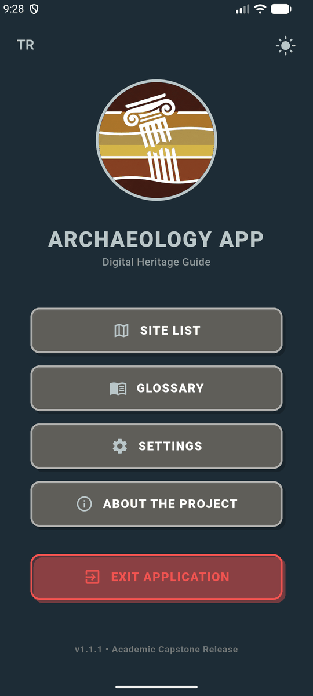
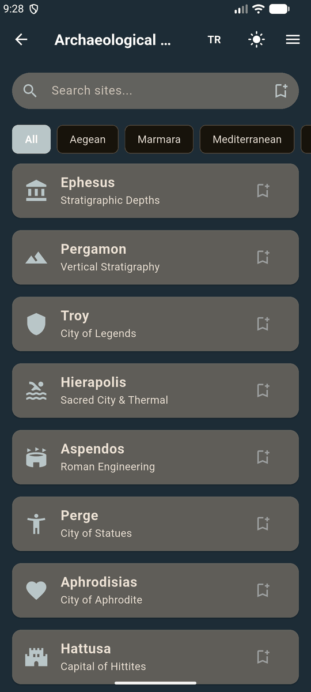
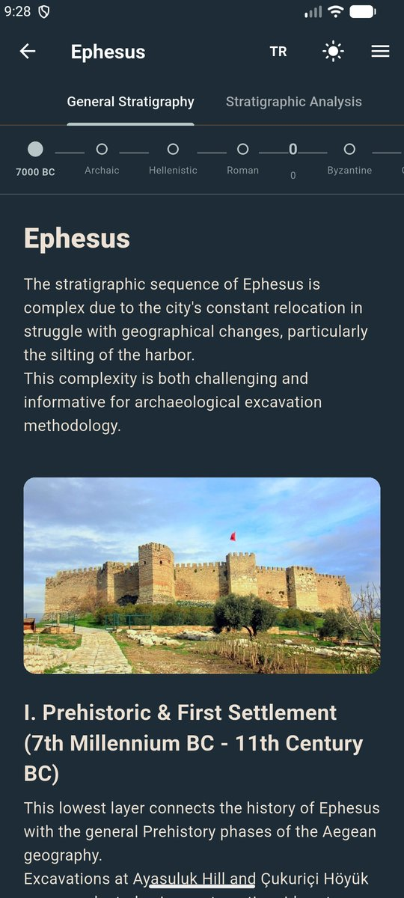
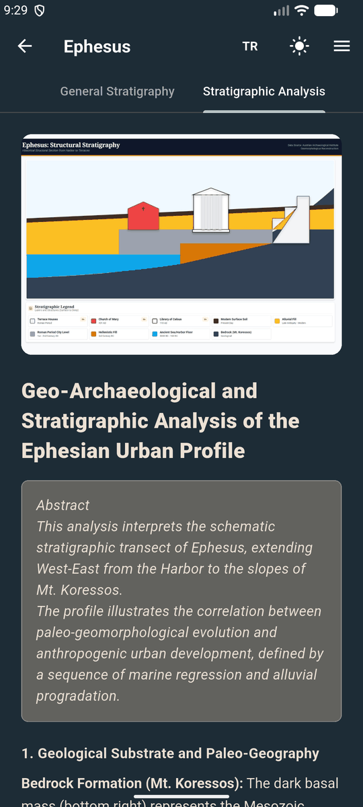
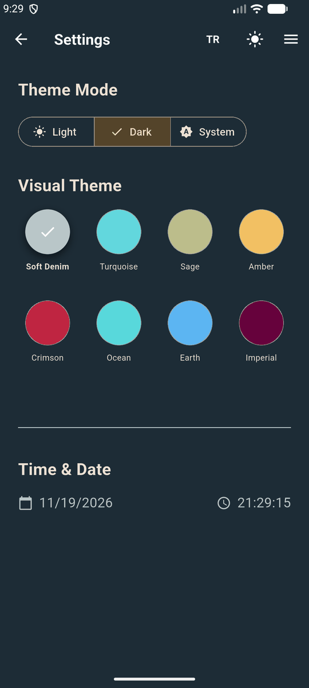
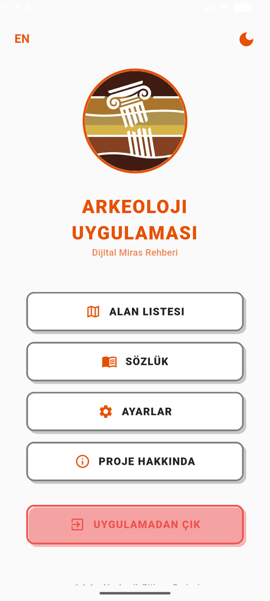
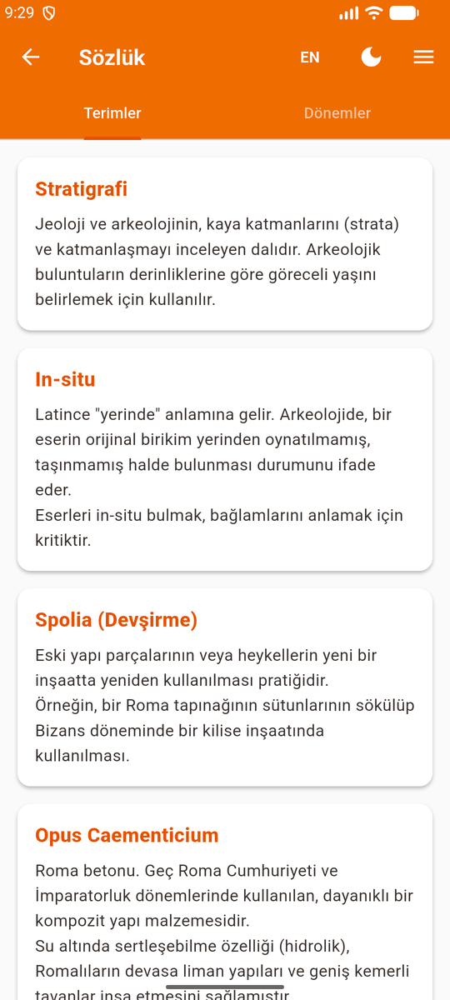
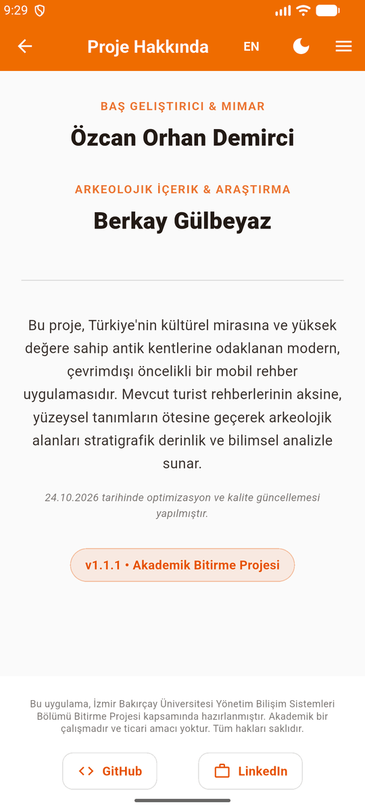

<h1 align="center">Anatolia Heritage</h1>

<p align="center">
  An offline, bilingual guide to 21 archaeological sites of Turkey.<br>
  <sub>Anadolu Mirası · English / Türkçe</sub>
</p>

<p align="center">
  
  
  
  <a href="https://github.com/OzcanOrhanDemirci/archaeology-app/releases/latest"></a>
  <a href="LICENSE"></a>
  
</p>

<p align="center">
  
  
  
  
</p>

<p align="center">
  <a href="#features">Features</a> ·
  <a href="#sites">Sites</a> ·
  <a href="#download">Download</a> ·
  <a href="#build-from-source">Build from source</a>
</p>

## About

Anatolia Heritage is a Flutter Android application for reading about archaeological sites, their settlement periods and stratigraphic layers. Site texts, photographs, analysis diagrams and the glossary are bundled with the app for offline use.

Özcan Orhan Demirci and Berkay Gülbeyaz developed it as a Senior Project at **İzmir Bakırçay University, Department of Management Information Systems**, in the autumn of 2025. The academic capstone version, **v1.0.0**, was completed on 1 January 2026.

An optimization and quality update on **24 October 2026** brought resized and recompressed photographs, saved preferences, system theme mode, region filters, synchronized timeline navigation and navigation fixes. The current app version is **v1.1.1 (build 3)**, with 21 sites.

The repository keeps the app as it was built: the graduation project of 2025–2026 with its October 2026 update.

## Features

- **Offline reading:** site histories, stratigraphic analyses, photographs and diagrams are included in the app.
- **English and Turkish:** switch the interface, site content and glossary language within the app.
- **Search and region filters:** search site names and descriptions, and narrow the list by geographic region.
- **Two-way timeline:** tap a linked period to scroll to its content; scrolling the content updates the selected timeline period.
- **Stratigraphic views:** read general stratigraphy and a separate analysis section with diagrams and explanatory text.
- **Image viewer:** tap site photographs and analysis images to open a full-screen, zoomable view.
- **Favorites:** save sites and revisit them from a dedicated list.
- **Appearance:** Light, Dark or System mode, plus eight color themes: Soft Denim, Turquoise, Sage, Amber, Crimson, Ocean, Earth and Imperial.
- **Saved choices:** language, theme mode, color theme and favorites persist between app launches.
- **Glossary:** separate tabs explain archaeological terms and historical periods.

<p align="center">
  
  
  
  
</p>

## Sites

The 21 sites below use the English names and regional groupings defined in the app.

| Region | Sites |
| --- | --- |
| Aegean | Ephesus, Pergamon, Hierapolis, Aphrodisias, Miletus, Priene, Didyma, Sardis, Kaunos, Laodicea |
| Marmara | Troy |
| Mediterranean | Aspendos, Perge, Xanthos, Sagalassos, Side, Myra, Termessos |
| Central Anatolia | Hattusa |
| Southeastern Anatolia | Mount Nemrut, Göbeklitepe |

## Download

**[Download the APK (v1.1.1, Android, about 86 MB)](https://github.com/OzcanOrhanDemirci/archaeology-app/releases/download/v1.1.1/anatolia-heritage-1.1.1.apk)**

Open the file on your Android device and allow installation from that source when asked. The APK is built from the [v1.1.1 tag](https://github.com/OzcanOrhanDemirci/archaeology-app/releases/tag/v1.1.1) without changes and signed with a local debug key, so it is a showcase build, not a Play Store app. Its SHA-256 is listed in the release's `SHA256SUMS`.

The academic capstone version is kept as the [v1.0.0 release](https://github.com/OzcanOrhanDemirci/archaeology-app/releases/tag/v1.0.0) (source only).

## Build from source

Use **Flutter 3.x stable**, a Dart SDK satisfying **`^3.9.2`**, and an Android development toolchain. Connect an Android device with USB debugging enabled or start an Android emulator.

```sh
git clone https://github.com/OzcanOrhanDemirci/archaeology-app.git
cd archaeology-app
flutter pub get
flutter run
flutter test
flutter build apk --release
```

The APK is written to `build/app/outputs/flutter-apk/app-release.apk`.

### Optional release signing

Create a keystore and describe it in `android/key.properties`. This file is git-ignored and must never be committed:

```properties
storePassword=<keystore password>
keyPassword=<key password>
keyAlias=upload
storeFile=<absolute path to upload-keystore.jks>
```

When valid signing properties are present, release builds use that keystore. Without them, the Android build configuration falls back to the local debug key.

## Architecture

`MyApp` owns the application state and exposes it through `AppStateProvider`, an **InheritedWidget**. No Bloc or Provider package is used. The site registry lazily constructs detailed `SiteData` through per-site functions; lightweight metadata supplies the site list, search and region filters.

`shared_preferences` saves preferences and favorites. `url_launcher` opens the About screen's external GitHub and LinkedIn buttons. Reading the guide works offline; external profile links require connectivity.

```text
lib/
├── main.dart                         # Startup, state ownership and themes
├── core/
│   ├── models.dart                   # Site, content and timeline models
│   └── utils.dart                    # Timeline selection and image viewer
├── data/
│   ├── localization.dart            # English and Turkish strings
│   ├── site_registry.dart           # On-demand site data builders
│   ├── sites.dart                   # Site metadata and regions
│   └── sites/                       # 21 site content files
├── screens/
│   ├── about_screen.dart
│   ├── favorites_screen.dart
│   ├── glossary_screen.dart
│   ├── home_screen.dart
│   ├── settings_screen.dart
│   ├── splash_screen.dart           # Main menu
│   └── universal_site_screen.dart   # Shared site detail screen
├── state/
│   └── state.dart                   # AppStateProvider
└── widgets/
    ├── app_bar.dart                 # Shared app bar
    ├── app_clickable.dart           # Tap feedback wrapper
    ├── app_drawer.dart              # Navigation drawer
    ├── site_widgets.dart            # Content and analysis blocks
    └── timeline.dart                # Horizontal period navigation
```

Tests in `test/` check:

- **Data integrity:** 21-site registry coverage, both languages, region labels, content structure, timeline targets and bundled image paths.
- **App startup and preferences:** menu startup, language retention and theme mode storage.
- **Region filtering:** filtering to the Aegean and returning to all sites.
- **Drawer navigation:** replacing destination screens without accumulating routes.
- **Timeline selection:** choosing the period from content positions, including entries without a target block.

## Team

| Contributor | Role |
| --- | --- |
| Özcan Orhan Demirci | Lead Developer & Architect |
| Berkay Gülbeyaz | Archaeological Content & Research |

## References

- Google. (2025). [Android Studio Documentation](https://developer.android.com/studio/intro). Android Developers.
- Google LLC. (2025). [Flutter Documentation: Build apps for any screen](https://docs.flutter.dev/).
- Google. (2025). [Dart Programming Language Specification](https://dart.dev/resources/language/spec).
- Google. (2024). [Material Design 3](https://m3.material.io/).
- Schneider, C., Fuller, M. A., Valacich, J. S., & George, J. F. (2020). *Information Systems Project Management: A Process Approach* (2nd ed.). Prospect Press.
- Republic of Turkey Ministry of Culture and Tourism. (2025). Archaeological Sites. [GoTürkiye](https://goturkiye.com/).
- Austrian Archaeological Institute (ÖAI). (2025). General Stratigraphic Analysis and Research. Austrian Academy of Sciences. [ÖAI](https://www.oeaw.ac.at/en/oeai/home).
- German Archaeological Institute (DAI). (2025). Archaeological Excavations and Research in Turkey. [DAI](https://www.dainst.org/en/).

## License

The source code is released under the [MIT License](LICENSE). Copyright (c) 2025-2026 Özcan Orhan Demirci. Site photographs and third-party content bundled with the app (images and cited research material) belong to their respective owners and are not covered by the MIT License.

## Contact

[mail@ozcanorhandemirci.com](mailto:mail@ozcanorhandemirci.com)
